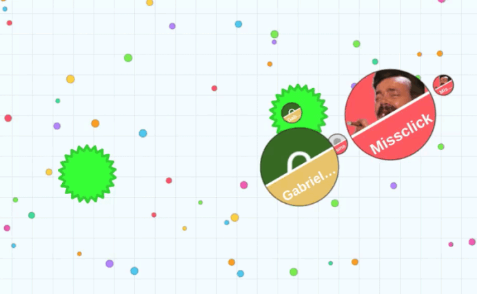

# Sadikoi


Web and Android client of [Sadikoi](https://sadikoi.missclick.net), a social game for groups of friends.

Every day, each group gets a new question such as *"Who'd be the first to throw up at a party?"*. Members vote for one of their friends, and the most voted player of the day wins an item (Dunce Cap, Leader's Cape, Traitor's Mask...) that they keep until someone else takes it. Each group also has a chat with GIF support.

<p align="center">
  
</p>

The backend lives in a separate repository: [Gabrieleirbag1/Sadikoi-API](https://github.com/Gabrieleirbag1/Sadikoi-API).

## Features

- Sign up with email/password or Google, password reset, new-device verification
- Create groups, invite friends with a link, pick question themes per group
- Daily question, votes, results and item announcements
- Real-time group chat with GIFs (Klipy)
- Push notifications on Android, with per-group settings
- Profile pictures, account settings, account deletion
- Bug reports, suggestions and user reports
- English and French
- Android app built from the same code with Capacitor, with links that open the app directly

## Tech stack

| | |
|---|---|
| Framework | Angular 21 (standalone components) |
| Language | TypeScript 5.9 |
| Translations | ngx-translate |
| Real time | socket.io-client |
| Mobile | Capacitor 8 (Android) |
| Captcha | Cloudflare Turnstile |
| Tests | Vitest |

## Project structure

```
.
├── src/
│   ├── app/
│   │   ├── components/     # Pages and UI components
│   │   ├── services/       # API calls, WebSocket, push, deep links...
│   │   ├── guards/         # Route guards
│   │   ├── interceptors/   # HTTP interceptors
│   │   └── app.routes.ts   # Routes
│   └── environments/       # API URL, site URL, feature flags
├── public/                 # Static files: images, translations (i18n/), assetlinks.json
├── android/                # Capacitor Android project
├── assets/                 # Source icon and splash screen for the Android app
├── docs/mobile.html        # Android guide
├── capacitor.config.ts
└── build_project.sh        # Production build and deploy to Apache
```

## Requirements

- Node.js 20.19+, 22.12+ or 24+
- npm
- The [Sadikoi API](https://github.com/Gabrieleirbag1/Sadikoi-API) running locally, for anything beyond the static pages
- Android Studio, only for the mobile app

## Installation

```bash
git clone https://github.com/Gabrieleirbag1/Sadikoi.git
cd Sadikoi
npm install
```

## Configuration

### Secrets

The Google sign-in client ID is kept out of git. Create `src/environments/secrets.ts` before building, or the build fails:

```ts
export const secrets = {
    googleClientId: '<your-web-client-id>.apps.googleusercontent.com',
};
```

Use the **Web** OAuth client ID from Google Cloud Console. It must match `GOOGLE_CLIENT_BROWSER_ID` on the backend.

### Environments

| File | Used by | API |
|---|---|---|
| `src/environments/environment.development.ts` | `ng serve` | `http://localhost:8082/api/` |
| `src/environments/environment.ts` | `ng build` (production) | `https://sadikoi.missclick.net/api/` |

| Key | Meaning |
|---|---|
| `apiUrl` | Base URL of the API |
| `siteUrl` | Public site URL, used for links shared outside the app |
| `pushNotificationsEnabled` | Enable push notifications in the Android app. Keep `false` without `android/app/google-services.json`, or the app crashes on startup. |
| `turnstileSiteKey` | Cloudflare Turnstile site key (public) |

## Running locally

Start the API first (see its README), then:

```bash
npm start
```

Open `http://localhost:4200`. The page reloads on every change.

## Build

```bash
npm run build
```

The output is in `dist/Sadikoi/browser`.

## Tests

```bash
npm test
```

## Deployment

The site is served by Apache on the same host as the API. `build_project.sh` builds for production and copies the result to `/var/www/Sadikoi/`:

```bash
./build_project.sh
```

It also copies `.htaccess`, which sends every unknown path to `index.html` so Angular routes work on reload. The Apache virtual host is in the API repository (`deploy/apache-sadikoi.conf`).

## Android app

The Android app is the same Angular build, packaged with Capacitor (`com.missclick.sadikoi`).

```bash
npx ng build && npx cap sync android   # Build the site and copy it into android/
npx cap open android                   # Open Android Studio, then Run
npm run assets                         # Regenerate the icon and splash screen from assets/
npm run android:release                # Build the signed AAB for the Play Store
```

Signing keys, Play Console, Google Sign-In, App Links and push notifications are covered in [`docs/mobile.html`](docs/mobile.html). Open it in a browser.

## Translations

UI strings are in `public/i18n/en.json` and `public/i18n/fr.json`. When you add a key, add it to both files.

## Contributing

1. Create a branch from `main`.
2. Format your code with Prettier (`.prettierrc`).
3. Add new UI strings to both translation files.
4. Run `npm test` and `npm run build` before opening a pull request.

## Author

**Gabriel Garrone** ([@Gabrieleirbag1](https://github.com/Gabrieleirbag1))

## License

This project is licensed under the MIT License. See [LICENSE](LICENSE).
